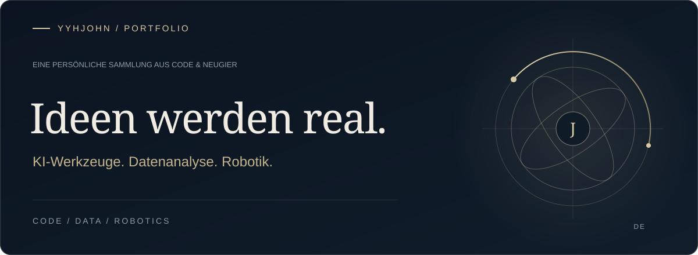
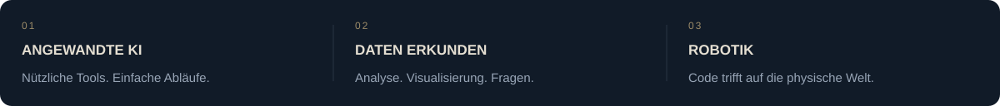

### Mein Ansatz

Ich entwickle praktische Software aus Ideen und erkunde die Schnittstellen von KI, Daten und Robotik.

Von Webanwendungen bis zur Robotersteuerung: eine Auswahl meiner Projekte und Experimente.

### Ausgewählte Projekte

<a href="https://github.com/yyhJohn?tab=repositories"><b>Alle Repositories ansehen ↗</b></a> &nbsp; · &nbsp; <a href="https://github.com/yyhJohn">GitHub-Profil</a>

---

Aus Neugier entwickelt. In der Praxis verfeinert.

