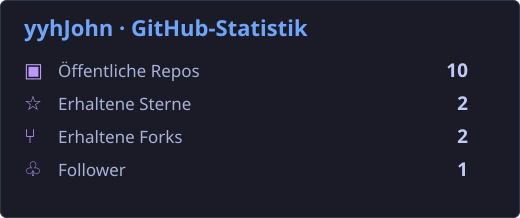
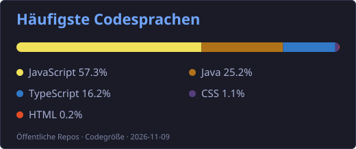
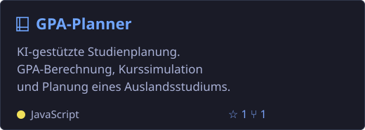
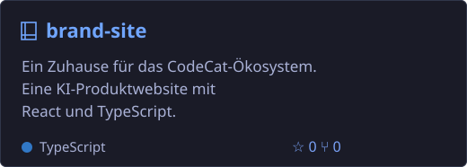
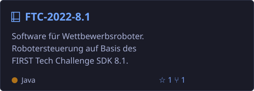
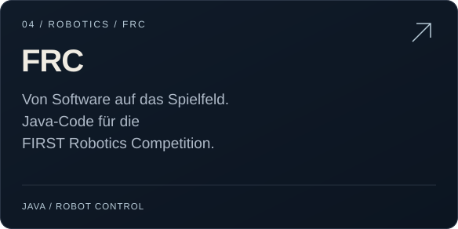

<h1 align="center">Hallo 👋, ich bin yyhJohn</h1>

<a href="https://github.com/yyhJohn/yyhJohn/blob/main/README.md">English</a> &nbsp; | &nbsp; <a href="https://github.com/yyhJohn/yyhJohn/blob/main/README.zh-CN.md">简体中文</a> &nbsp; | &nbsp; <a href="https://github.com/yyhJohn/yyhJohn/blob/main/README.ja.md">日本語</a> &nbsp; | &nbsp; <b>Deutsch</b> &nbsp; | &nbsp; <a href="https://github.com/yyhJohn/yyhJohn/blob/main/README.fr.md">Français</a> &nbsp; | &nbsp; <a href="https://github.com/yyhJohn/yyhJohn/blob/main/README.es.md">Español</a>

## 👨‍💻 Über mich

- 🔭 Ich entwickle praktische KI-Werkzeuge und Webanwendungen.
- 📊 Ich erkunde Datenanalyse, Visualisierung und Forschungswerkzeuge.
- 🤖 Ich programmiere FTC- und FRC-Roboter mit Java.

## 🛠️ Sprachen & Werkzeuge

## 📊 GitHub-Statistik

## 🚀 Ausgewählte Projekte

<a href="https://github.com/yyhJohn?tab=repositories">Alle Repositories ansehen →</a> &nbsp; · &nbsp; <a href="https://github.com/yyhJohn">GitHub-Profil</a>

