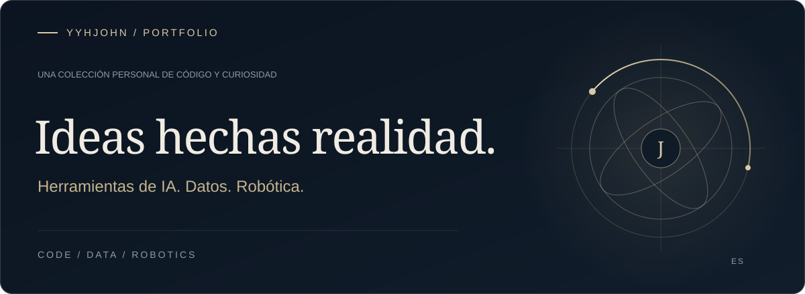
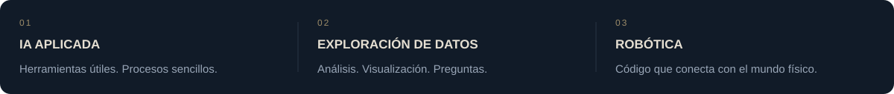

### Mi enfoque

Me gusta convertir ideas en software útil y explorar la intersección entre IA, datos y robótica.

De aplicaciones web al control de robots: una selección de lo que construyo y exploro.

### Proyectos destacados

<a href="https://github.com/yyhJohn?tab=repositories"><b>Ver todos los repositorios ↗</b></a> &nbsp; · &nbsp; <a href="https://github.com/yyhJohn">Perfil de GitHub</a>

---

Creado con curiosidad. Refinado con práctica.

