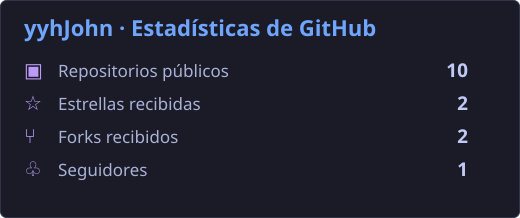
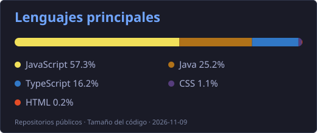
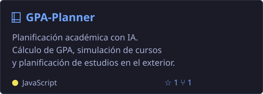
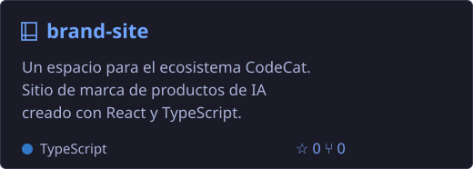
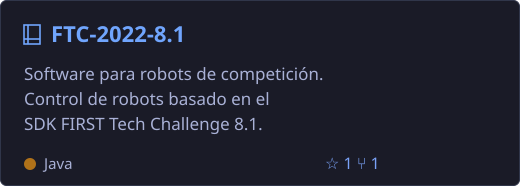
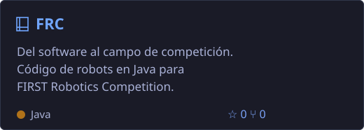

<h1 align="center">Hola 👋, soy yyhJohn</h1>

<a href="https://github.com/yyhJohn/yyhJohn/blob/main/README.md">English</a> &nbsp; | &nbsp; <a href="https://github.com/yyhJohn/yyhJohn/blob/main/README.zh-CN.md">简体中文</a> &nbsp; | &nbsp; <a href="https://github.com/yyhJohn/yyhJohn/blob/main/README.ja.md">日本語</a> &nbsp; | &nbsp; <a href="https://github.com/yyhJohn/yyhJohn/blob/main/README.de.md">Deutsch</a> &nbsp; | &nbsp; <a href="https://github.com/yyhJohn/yyhJohn/blob/main/README.fr.md">Français</a> &nbsp; | &nbsp; <b>Español</b>

## 👨‍💻 Sobre mí

- 🔭 Desarrollo herramientas de IA útiles y aplicaciones web.
- 📊 Exploro el análisis de datos, la visualización y las herramientas de investigación.
- 🤖 Programo robots FTC y FRC con Java.

## 🛠️ Lenguajes y herramientas

## 📊 Estadísticas de GitHub

## 🚀 Proyectos destacados

<a href="https://github.com/yyhJohn?tab=repositories">Ver todos los repositorios →</a> &nbsp; · &nbsp; <a href="https://github.com/yyhJohn">Perfil de GitHub</a>

