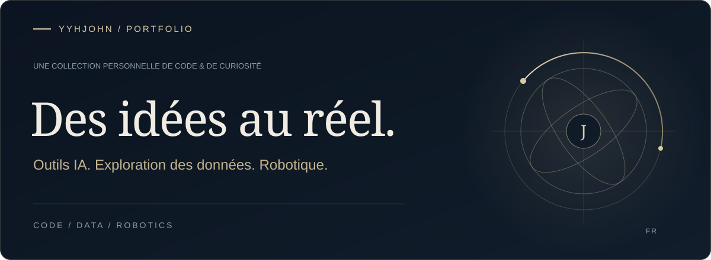
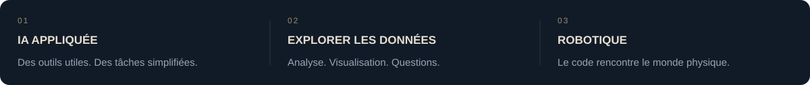
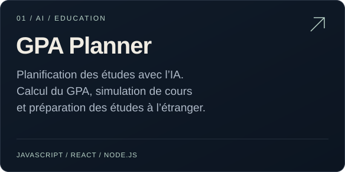
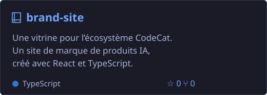
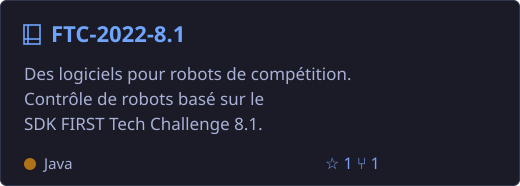
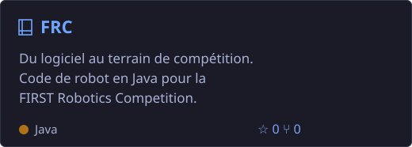

### Ma démarche

J’aime transformer des idées en logiciels utiles et explorer les liens entre IA, données et robotique.

Des applications web au contrôle de robots, voici une sélection de mes projets et explorations.

### Projets sélectionnés

<a href="https://github.com/yyhJohn?tab=repositories"><b>Voir tous les dépôts ↗</b></a> &nbsp; · &nbsp; <a href="https://github.com/yyhJohn">Profil GitHub</a>

---

Créé par curiosité. Affiné par la pratique.

