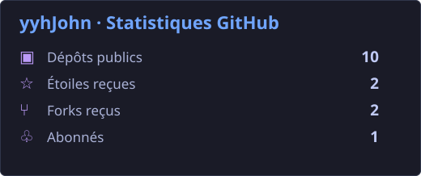
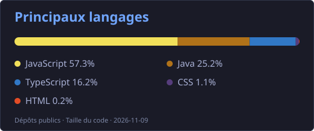

<h1 align="center">Bonjour 👋, moi c’est yyhJohn</h1>

<a href="https://github.com/yyhJohn/yyhJohn/blob/main/README.md">English</a> &nbsp; | &nbsp; <a href="https://github.com/yyhJohn/yyhJohn/blob/main/README.zh-CN.md">简体中文</a> &nbsp; | &nbsp; <a href="https://github.com/yyhJohn/yyhJohn/blob/main/README.ja.md">日本語</a> &nbsp; | &nbsp; <a href="https://github.com/yyhJohn/yyhJohn/blob/main/README.de.md">Deutsch</a> &nbsp; | &nbsp; <b>Français</b> &nbsp; | &nbsp; <a href="https://github.com/yyhJohn/yyhJohn/blob/main/README.es.md">Español</a>

## 👨‍💻 À propos

- 🔭 Je crée des outils IA utiles et des applications web.
- 📊 J’explore l’analyse de données, la visualisation et les outils de recherche.
- 🤖 Je programme des robots FTC et FRC en Java.

## 🛠️ Langages et outils

## 📊 Statistiques GitHub

## 🚀 Projets sélectionnés

<a href="https://github.com/yyhJohn?tab=repositories">Voir tous les dépôts →</a> &nbsp; · &nbsp; <a href="https://github.com/yyhJohn">Profil GitHub</a>

