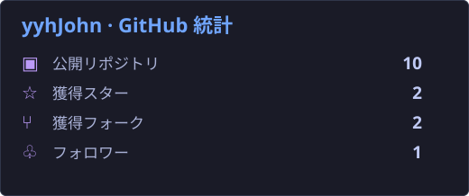
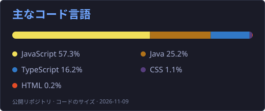
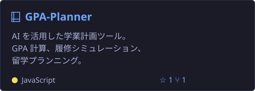
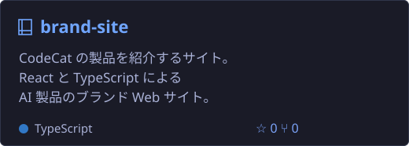
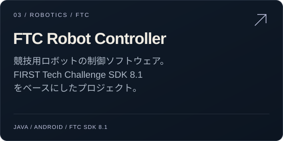
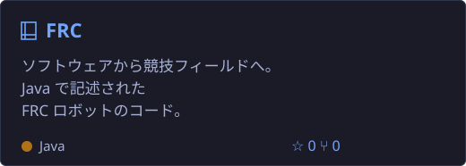

<h1 align="center">こんにちは 👋、yyhJohn です</h1>

<a href="https://github.com/yyhJohn/yyhJohn/blob/main/README.md">English</a> &nbsp; | &nbsp; <a href="https://github.com/yyhJohn/yyhJohn/blob/main/README.zh-CN.md">简体中文</a> &nbsp; | &nbsp; <b>日本語</b> &nbsp; | &nbsp; <a href="https://github.com/yyhJohn/yyhJohn/blob/main/README.de.md">Deutsch</a> &nbsp; | &nbsp; <a href="https://github.com/yyhJohn/yyhJohn/blob/main/README.fr.md">Français</a> &nbsp; | &nbsp; <a href="https://github.com/yyhJohn/yyhJohn/blob/main/README.es.md">Español</a>

## 👨‍💻 自己紹介

- 🔭 実用的な AI ツールと Web アプリを制作しています。
- 📊 データ分析・可視化・研究ツールに関心があります。
- 🤖 Java で FTC・FRC ロボットのプログラムを作っています。

## 🛠️ 言語とツール

## 📊 GitHub 統計

## 🚀 主なプロジェクト

<a href="https://github.com/yyhJohn?tab=repositories">すべてのリポジトリ →</a> &nbsp; · &nbsp; <a href="https://github.com/yyhJohn">GitHub プロフィール</a>

