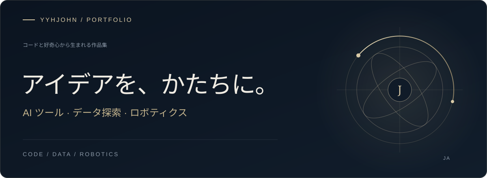

### ものづくりへの姿勢

アイデアを実用的なソフトウェアに変え、AI・データ・ロボティクスの接点を探っています。

Web アプリからロボット制御まで。制作と探究のプロジェクトを紹介します。

### 主なプロジェクト

<a href="https://github.com/yyhJohn?tab=repositories"><b>すべてのリポジトリ ↗</b></a> &nbsp; · &nbsp; <a href="https://github.com/yyhJohn">GitHub プロフィール</a>

---

好奇心から始まり、実践で磨く。

