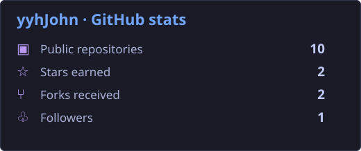
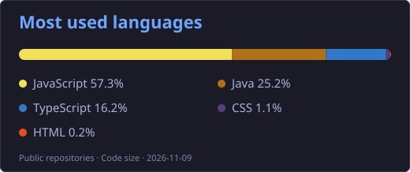
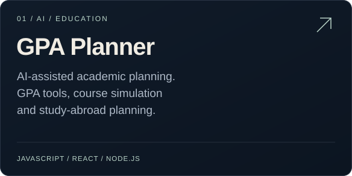
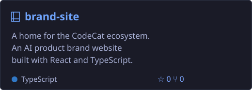
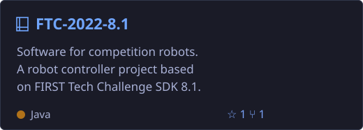
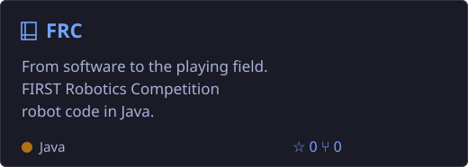

<h1 align="center">Hi 👋, I'm yyhJohn</h1>

<b>English</b> &nbsp; | &nbsp; <a href="https://github.com/yyhJohn/yyhJohn/blob/main/README.zh-CN.md">简体中文</a> &nbsp; | &nbsp; <a href="https://github.com/yyhJohn/yyhJohn/blob/main/README.ja.md">日本語</a> &nbsp; | &nbsp; <a href="https://github.com/yyhJohn/yyhJohn/blob/main/README.de.md">Deutsch</a> &nbsp; | &nbsp; <a href="https://github.com/yyhJohn/yyhJohn/blob/main/README.fr.md">Français</a> &nbsp; | &nbsp; <a href="https://github.com/yyhJohn/yyhJohn/blob/main/README.es.md">Español</a>

## 👨‍💻 About me

- 🔭 Building practical AI tools and web applications.
- 📊 Exploring data analysis, visualization, and research tools.
- 🤖 Programming robots with Java through FTC and FRC projects.

## 🛠️ Languages & tools

## 📊 GitHub stats

## 🚀 Featured projects

<a href="https://github.com/yyhJohn?tab=repositories">Explore all repositories →</a> &nbsp; · &nbsp; <a href="https://github.com/yyhJohn">GitHub profile</a>

