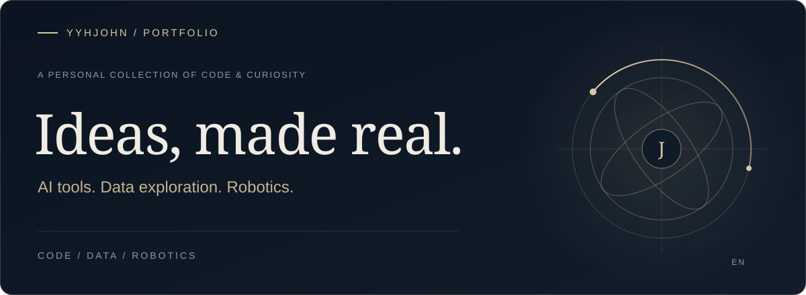
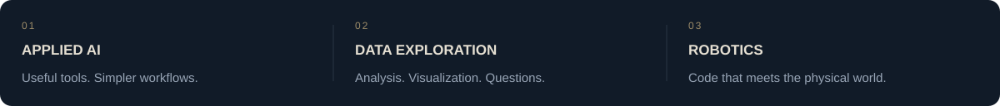

### The approach

I enjoy turning ideas into practical software and exploring the intersection of AI, data, and robotics.

From web applications to robot controllers, this is a selection of what I build and explore.

### Selected work

<a href="https://github.com/yyhJohn?tab=repositories"><b>Explore all repositories ↗</b></a> &nbsp; · &nbsp; <a href="https://github.com/yyhJohn">GitHub profile</a>

---

Built with curiosity. Refined through practice.

