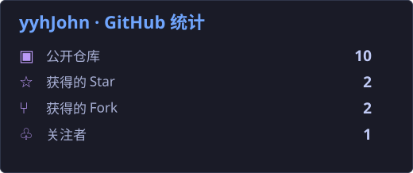
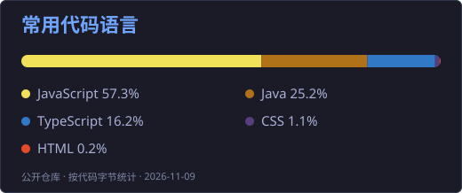
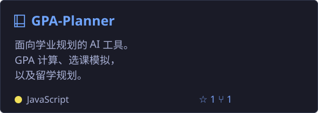
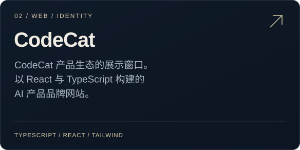
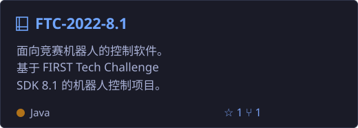
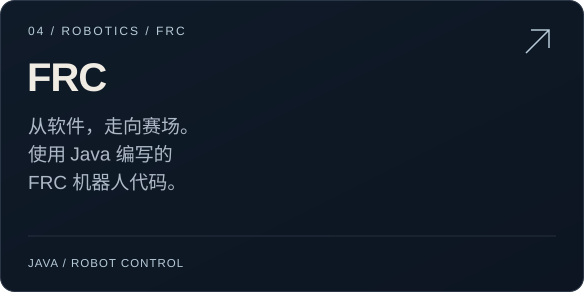

<h1 align="center">你好 👋，我是 yyhJohn</h1>

<a href="https://github.com/yyhJohn/yyhJohn/blob/main/README.md">English</a> &nbsp; | &nbsp; <b>简体中文</b> &nbsp; | &nbsp; <a href="https://github.com/yyhJohn/yyhJohn/blob/main/README.ja.md">日本語</a> &nbsp; | &nbsp; <a href="https://github.com/yyhJohn/yyhJohn/blob/main/README.de.md">Deutsch</a> &nbsp; | &nbsp; <a href="https://github.com/yyhJohn/yyhJohn/blob/main/README.fr.md">Français</a> &nbsp; | &nbsp; <a href="https://github.com/yyhJohn/yyhJohn/blob/main/README.es.md">Español</a>

## 👨‍💻 关于我

- 🔭 动手构建实用的 AI 工具和网页应用。
- 📊 探索数据分析、可视化与研究工具。
- 🤖 使用 Java 编写 FTC、FRC 机器人项目。

## 🛠️ 语言与工具

## 📊 GitHub 统计

## 🚀 精选项目

<a href="https://github.com/yyhJohn?tab=repositories">浏览全部仓库 →</a> &nbsp; · &nbsp; <a href="https://github.com/yyhJohn">GitHub 个人主页</a>

