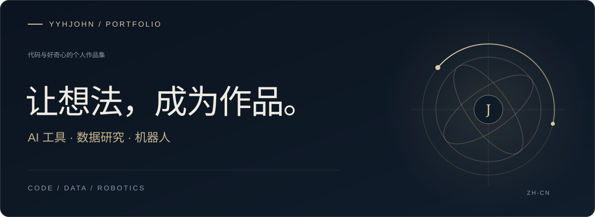

### 关于创造

我喜欢把想法写成实用的软件，探索 AI、数据与机器人的交汇之处。

从网页应用到机器人控制，这里记录着我动手构建与探索的项目。

### 精选作品

<a href="https://github.com/yyhJohn?tab=repositories"><b>浏览全部仓库 ↗</b></a> &nbsp; · &nbsp; <a href="https://github.com/yyhJohn">GitHub 个人主页</a>

---

源于好奇，成于实践。

